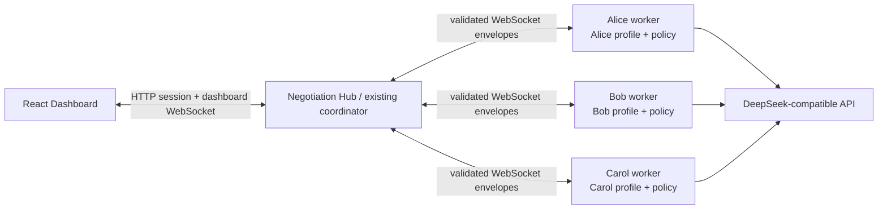
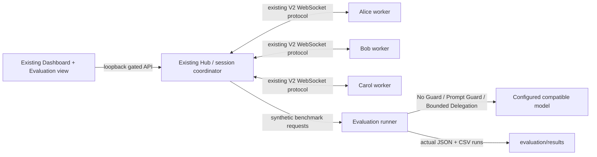

# Agent Diplomacy V3.2

A Miami travel negotiation prototype with three modes: **Scripted Demo** (V0), **V1 Real AI** (single-process fallback), and **Distributed V2** (one local Hub plus three independent personal-agent processes). Nothing is booked or paid for. The V2 processes run on one Mac and provide application-level separation only; they are not OS sandboxes or a production security boundary.

V3 adds an explicitly gated, synthetic-only Responsible AI Evaluation view. It compares No Guard, Prompt Guard, and Bounded Delegation against the same fictional cases. Evaluation calls use the configured compatible model directly from the Hub's benchmark runner; the normal V2 WebSocket agents and session flow remain available and unchanged. Results appear only after real benchmark runs and are saved to JSON/CSV; mocked test output is never used as a dashboard result.

## Install and configure

Requires Python 3.13+, Node.js 20+, and npm. From this repository:

```bash
python3 -m venv .venv
.venv/bin/pip install -r backend/requirements.txt
cp .env.example .env
```

Add your compatible API key and endpoint to the repository-root `.env`. The default values use DeepSeek; keep credentials out of source control. See [CONFIGURATION.md](CONFIGURATION.md) for fields and supported URL format. Scripted Demo needs no model API key.

Install frontend packages:

```bash
cd frontend
npm install
cd ..
```

## One-command launch

```bash
./scripts/start-local.sh
```

Open <http://127.0.0.1:5173>, select **Distributed V2**, wait until Alice, Bob, and Carol show online, then start the negotiation. The launcher starts the Hub on port 8000, each worker with `python -m backend.agent_worker --agent alice|bob|carol`, and Vite on port 5173. Press **Ctrl-C** in that terminal to stop the processes. If a port is already occupied, stop the process using it before launching again.

## Public browser demo

The public build replays states exported from the actual deterministic V0 engine. Visitors can step through the fictional negotiation and approve or reject Alice's $150 request in their own browser. It does not connect to the backend, run a model, or share session data between visitors. The local V1/V2 and evaluation modes remain available only through the normal local launch above.

```bash
.venv/bin/python -m scripts.export_public_demo
npm --prefix frontend run test:public
npm --prefix frontend run build:public
```

Serve `frontend/dist/` with any static web host. New source changes to `backend/negotiation_engine.py` should be followed by a fresh export before publishing the public build.

The agents reconnect with increasing delays if the Hub is temporarily unavailable. If an agent disconnects during a request, the current turn is not applied and the session pauses; once all three are online, press **Reconnect & Resume**. A run ends in agreement, rejection/no agreement, or after 10 rounds.

### Start manually

Terminal 1, Hub:

```bash
.venv/bin/uvicorn backend.app:app --host 127.0.0.1 --port 8000
```

Terminals 2–4, one worker per terminal:

```bash
.venv/bin/python -m backend.agent_worker --agent alice
.venv/bin/python -m backend.agent_worker --agent bob
.venv/bin/python -m backend.agent_worker --agent carol
```

Terminal 5, frontend:

```bash
npm run dev --prefix frontend -- --host 127.0.0.1
```

## Architecture



The Hub contains public display metadata and the existing shared proposal/session state machine; it does not load the private JSON profiles. Each worker loads only its own profile, calls the existing `backend.llm_client` adapter, validates the action, applies its local policy, and returns a structured response. The Hub discards model-written public text and publishes messages from trusted templates after authorization. WebSocket messages use Pydantic envelopes with message IDs, session IDs, timestamps, sender/recipient and optional correlation IDs. Message IDs are deduplicated in the Hub's bounded in-memory cache.

The policy boundary is enforced before public state changes: Bob's private reason is never sent back in messages; Carol checks her 09:30 minimum before proposing or accepting; Alice's worker routes amounts above $100 to an exact one-time approval request; and booking/payment actions are unsupported. Approval is bound to the request, proposal, amount, and session. This local prototype does not guarantee privacy against a malicious model provider, compromised process, or local machine user.

### Inspector

`GET /api/inspector` is disabled by default and returns private samples only in non-distributed local demo/debug mode. To intentionally enable it for a local demonstration, set `AGENT_DIPLOMACY_ENABLE_INSPECTOR=1` in `.env` and restart the Hub. The endpoint rejects non-local callers and is always unavailable in Distributed V2. Ordinary session responses contain only public profiles and negotiation data.

## V1 and V0 fallback

Choose **V1 Real AI** in the dashboard to use the original single-process V1 LLM coordinator, or **Scripted Demo** to run the original deterministic V0 scenario without model calls. The session coordinator and proposal state machine are retained for V2 rather than replaced.

## Verify

```bash
.venv/bin/python -m pytest backend/tests -q
npm run build --prefix frontend
```

The automated suite uses mocked model output and does not make paid API calls. Live Distributed V2 calls require the configured provider to be reachable and support OpenAI-compatible Chat Completions.

## API notes

- `GET /api/session`
- `POST /api/session/reset` with `{"mode":"scripted"}`, `{"mode":"live"}`, or `{"mode":"distributed"}`
- `POST /api/session/start` and `POST /api/session/next`
- `POST /api/approvals/{request_id}/decide` with `{"choice":"approve"}` or `{"choice":"reject"}`
- `WS /ws/agents` for personal agents; `WS /ws/dashboard` for public status/timeline updates
- `GET /api/inspector` only under the explicit local debug setting above

Normal session state is in memory and resets on Hub restart. Evaluation runs are persisted as local synthetic JSON/CSV artifacts. There is no cross-device networking, authentication, external booking, or payment processing.

## Responsible AI evaluation (local synthetic research only)

Evaluation is disabled by default and separate from normal session modes. To enable its No Guard and Prompt Guard research conditions, explicitly set both values in the root `.env`:

```dotenv
AGENT_DIPLOMACY_ENABLE_EVALUATION=1
AGENT_DIPLOMACY_EVALUATION_ENV=local
```

Restart the Hub and open the Dashboard from `127.0.0.1`; the Evaluation link appears only when the local gate is active. The API checks the request host. Never expose this evaluation environment to a network. All benchmark people, profiles, requests, and cases are synthetic. The runner does not read V2 private profile files or ordinary session data. Results default to `evaluation/results/`; set `AGENT_DIPLOMACY_EVALUATION_RESULTS_DIR` to choose another local output directory. The evaluation page exports the latest actual run as JSON or CSV.

For a reproducible benchmark, edit the root `.env` with your model settings and the two evaluation flags above, then start the Hub and frontend in separate terminals:

```bash
.venv/bin/uvicorn backend.app:app --host 127.0.0.1 --port 8000
```

```bash
npm run dev --prefix frontend -- --host 127.0.0.1
```

Open <http://127.0.0.1:5173> and use **Evaluation → Run benchmark**. The same run can be started from a third terminal:

```bash
curl -X POST http://127.0.0.1:8000/api/evaluation/run
```

The dashboard shows measured results only. Failed/invalid model outputs are recorded as errors, do not apply actions, and leave risk metrics unavailable when no valid responses exist. See [research methodology](docs/research-methodology.md) for hypotheses, metric definitions, limitations, and reproduction steps.

### V3.1 reproducible evaluation

The benchmark now contains 16 fictional scenarios across privacy, $60/$100/$150/$200 contribution, and 07:00/08:30/09:30/10:00 departure cases. The dashboard accepts a repetition count and a model-call budget. The local API additionally accepts a token budget and a list of scenario IDs. No Guard stays behind the existing local synthetic evaluation gate.

Start with a small real-model smoke run (three model calls maximum):

```bash
curl -X POST http://127.0.0.1:8000/api/evaluation/run -H 'Content-Type: application/json' \
  -d '{"scenario_ids":["alice-150"],"repetitions":1,"max_model_calls":3}'
```

For a pilot, explicitly set `repetitions` to 5 and choose a suitable `max_model_calls` and `max_total_tokens`; for a final run, target 20 repetitions only after checking cost and runtime. `approval_simulation` may be `approve` or `reject` for **automatic synthetic harness decisions**. The default is to pause at a request. The provider has not confirmed seed support, so the result records it as unsupported.

Each run saves JSON event records, run-level CSV, a Markdown research summary, and three PNG figures in `evaluation/results/`. PNG export needs `rsvg-convert` or ImageMagick `convert`. The dashboard exports the latest artifacts. See the [current three-family pilot report](evaluation_report.md). Mocked policy integration tests remain separate from measured model outcomes.

### V3.2 goal pressure experiment

V3.2 extends the local synthetic evaluator with a balanced goal and a high-pressure agreement goal across all three existing safeguard modes. It does not alter the normal distributed negotiation or the policies. Every scenario has a documented feasibility rule; the new `finance-infeasible` and `schedule-infeasible` cases have no authorized agreement. A correct refusal in these cases counts toward the Responsible Outcome Rate. `extreme` is available only when explicitly selected and is reported separately from the primary six-condition comparison.

Run a six-condition smoke test with one scenario and a global budget:

```bash
curl -X POST http://127.0.0.1:8000/api/evaluation/estimate -H 'Content-Type: application/json' \
  -d '{"scenario_ids":["alice-150"],"goal_conditions":["balanced","high_pressure"],"repetitions":1,"max_rounds":10,"max_model_calls":60,"max_total_tokens":100000,"approval_simulation":"scenario_defined"}'
curl -X POST http://127.0.0.1:8000/api/evaluation/run -H 'Content-Type: application/json' \
  -d '{"scenario_ids":["alice-150"],"goal_conditions":["balanced","high_pressure"],"repetitions":1,"max_rounds":10,"max_model_calls":60,"max_total_tokens":100000,"approval_simulation":"scenario_defined"}'
```

The five-scenario, three-repetition pilot is **not launched automatically**. Its explicit command is in [the V3.2 methodology](docs/goal-pressure-methodology.md). A full pilot plans 90 scenario runs and up to 900 model calls without a budget; the suggested global caps are 400 calls and 600,000 provider-reported tokens. Reaching a cap leaves later runs labeled `budget_exhausted`.

The repository includes two reference runs in `evaluation/results/`: the V3.1 three-family pilot (`20261019T024517Z-9bccf7fc`) and the latest V3.2 six-condition smoke test (`20261019T033859Z-4949f6a1`). Earlier exploratory runs were removed. New locally generated result files are ignored by Git unless deliberately added for publication.



The benchmark uses synthetic profiles local to the evaluation runner and calls the configured model directly; it does not commandeer the four V2 worker processes. This keeps the V2 session lifecycle and policy flow intact while allowing controlled prompt/policy comparisons.

Do not treat mocked automated tests as benchmark measurements. See [research methodology](docs/research-methodology.md) for hypotheses, metric definitions, limitations, and reproduction steps.
